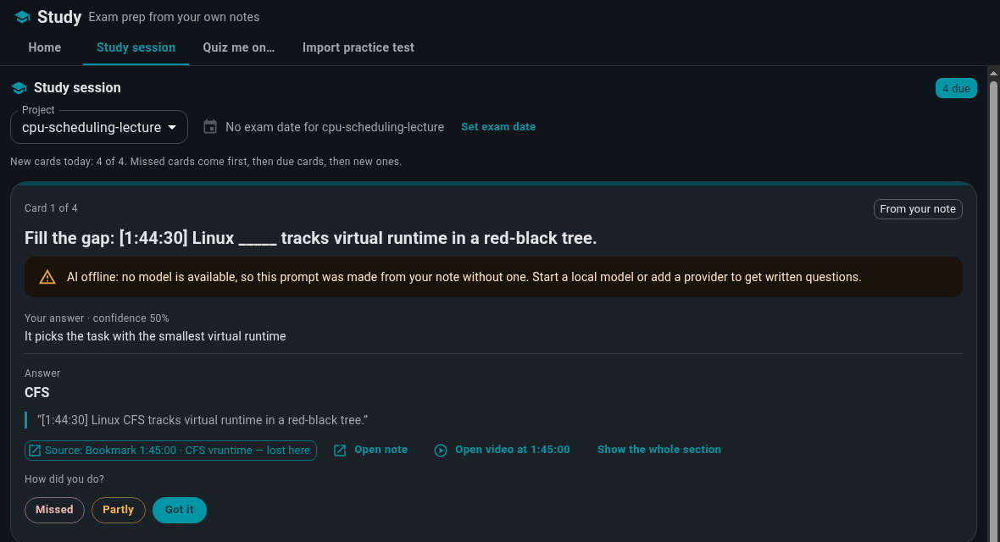

# Learning from video

**Who this is for:** you learn from lectures, talks, interviews or podcasts, on YouTube or saved
on your computer, and you want to ask questions about them and jump straight to the moment an
answer came from.

**In about 10 minutes you'll have:** one video turned into searchable transcript notes, a cited
answer about it, and a citation that moves the player to the right moment.

## 1. Install

Download Vault from the
[Releases page](https://github.com/tosin2013/local-knowledge-vault/releases) and open it. The
[README](../../README.md#download) has the macOS and Linux first-run notes.

**For YouTube you also need [`yt-dlp`](https://github.com/yt-dlp/yt-dlp),** the tool Vault uses
to fetch captions. The recommended install includes the browser impersonation that avoids YouTube
"too many requests" (HTTP 429) errors:

```bash
pipx install "yt-dlp[default,curl-cffi]"
```

On Linux, use the `.deb`, `.rpm` or AppImage build for YouTube: the confined `.snap` can't reach a
`yt-dlp` installed outside it. Local video and audio files don't need `yt-dlp` at all.

## 2. Set up a model

Any model works. Locally, install [Ollama](https://ollama.com) and run `ollama pull qwen3:8b`.
Otherwise see [Quickest setup with a cloud model](cloud-quickstart.md). Bringing a video in
doesn't need a model. Asking about it does.

## 3. Your first session

1. **Open Media chat.** Click **Media chat** at the top of the window. It's also under
   **Plugins**.
2. **Bring in a video.** Under **Ingest**, either:
   - paste a YouTube link into the box that shows `https://youtube.com/watch?v=…` and click
     **Ingest YouTube**, or
   - click **Local video/audio + captions** and pick a video or audio file. If a `.srt` or `.vtt`
     file with the same name sits next to it, Vault uses it. Otherwise it asks you to choose the
     captions file.

   A progress bar shows each stage, with **Cancel**. The captions become timed transcript notes
   in a project named after the video.
3. **Ask about it.** Type in the box that says **Ask about this media…** and press Enter. The answer
   cites transcript notes, each covering a stretch of the video.
4. **Jump to the moment.** Click a citation. The player seeks to that part of the video, for
   YouTube and local files alike.
5. **Ask about what's on screen.** Type a question and click **Ask about this moment** to ask
   about the part of the video at the playhead. **Follow playhead** is on by default, so every
   question also carries the current time. Switch it off to ask about the whole video.
6. **Keep what matters.** Two buttons open a new note marked **AI draft**. Click **Save** in it to
   keep it.
   - **Save this moment** saves the transcript from about 45 seconds either side of the playhead,
     with the video's link and time range.
   - **Save as note** under an answer saves that answer.
7. **Come back later.** Pick the video from **Open media project**.

## 4. What to expect

- **Cited answers from the transcript,** with a seekable citation for each point.
- **Honest gaps:** if the video doesn't cover your question, the answer says so.
- **The transcript is part of your vault.** Ask (the main screen) can use it too, ranked after
  your own notes. The **Transcripts** switch in the notes list shows or hides transcript notes.
- **Voices:** voice chips in Media chat switch the speaking style (**Media reader** by default). Add
  ready-made ones (**Desk cohost**, **Curious student**, **Skeptical investor**) or your own under
  **Plugins → Media voices**. A voice changes style only, never the citation rules.

## 5. Study a video

These tools follow Study's rule: you answer or write first, then Vault checks what you wrote against
the transcript and cites it.

**Bookmarks**

1. Press **B**, or click **Bookmark (B)**, to mark the moment. This also works in fullscreen. Add a
   label and a tag (**Review**, **Confused**, **Exam** or your own). Each bookmark shows as a tick
   on the timeline.
2. From the **Bookmarks** panel, jump back to a moment, ask about it, **Summarize my bookmarks**, or
   **Save as note**.
3. **Make cards from bookmarks** turns them into Study cards. Confused bookmarks come first. When a
   card is revealed in Study, **Open video at …** reopens the video at that moment. Making cards
   twice never makes duplicates.



**Exam tutor**

1. Pick the **Exam tutor** voice and click **Quiz me on this part**. You can also type "quiz me", or
   use the cap icon on a bookmark.
2. Answer from memory, or click **I don't know**. **Hint** helps in up to three steps without giving
   the answer away.
3. Rate your confidence (**Low**, **Medium** or **High**) and reveal the answer. The tutor grades it
   Missed, Partly or Got it, cites the transcript, and offers **Rewatch** at the right time.
4. If you got it right, it asks **Why is that?** in one sentence. If you missed it, you can bookmark
   it as Confused or make a Study card. If the project has a note titled "objectives", questions are
   tagged with the matching objective, but only when that note is cited.

**Study guide and research notes**

1. Under **Notes while watching**, click **Start study guide** or **Start research notes**. Vault
   creates a note in the project.
2. At each chapter boundary (or every 10 minutes, which you can change, turn off or snooze), Vault
   pauses and asks **In your own words…**. Press **G** to open a checkpoint any time.
3. **Check my summary** shows what you covered, questions to rewatch for (never the answers), and
   claims this part of the transcript doesn't support, each with a timestamp. Tick what goes into
   your guide and click **Save to guide**.
4. Add **key terms** with your own definitions, and Vault checks each one against the transcript. In
   research notes, add claims, evidence, quotes, your take and open questions. A quote must match
   the transcript exactly, or Vault offers to save it as a claim. **Find related notes in my vault**
   links to notes you already have.
5. **Draft it for me** is there if you want it. The draft is marked AI draft until you rewrite it or
   add a line in your own words.
6. **Review these** lists your bookmarks and Exam tutor misses. **Make Study cards from key terms &
   gaps** adds cards and suggests a first review date based on your exam date.

## 6. Tips and limits

- **Captions are required.** Vault doesn't transcribe audio itself. YouTube videos need English
  captions (uploaded or auto-generated). For local files, bring an `.srt` or `.vtt`.
- **YouTube errors:** if YouTube keeps refusing (HTTP 429), update `yt-dlp` with the install line
  above. Or set `LKV_YTDLP_EXTRA_ARGS="--cookies-from-browser firefox"` before starting Vault to
  use your browser's YouTube session. Local captions always work.
- **Bringing the same video in again** replaces its transcript notes, and old citations to those
  notes stop working. Vault asks before it does this.
- **What goes online:** only YouTube links contact YouTube (through `yt-dlp` and the embedded
  player). Local files stay on your computer.
- Player and chat can go fullscreen together with the fullscreen button.
- Chapters for checkpoints come from YouTube's chapter list when you bring a YouTube video in.
  Local files and videos without chapters use the every-N-minutes setting.

## Next steps

- [Students and exam prep](students.md): turn lecture notes into recall practice and spaced
  review.
- [PLUGINS.md](../../PLUGINS.md#media-chat-first-plugin): Media chat and Media voices in detail.
